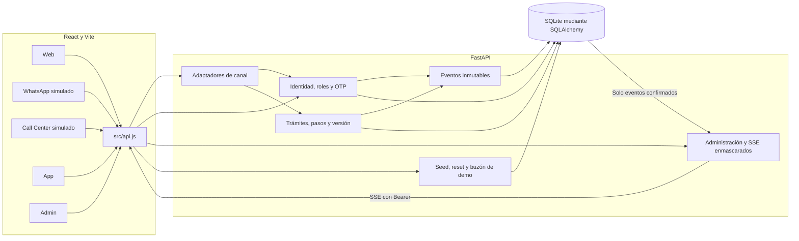
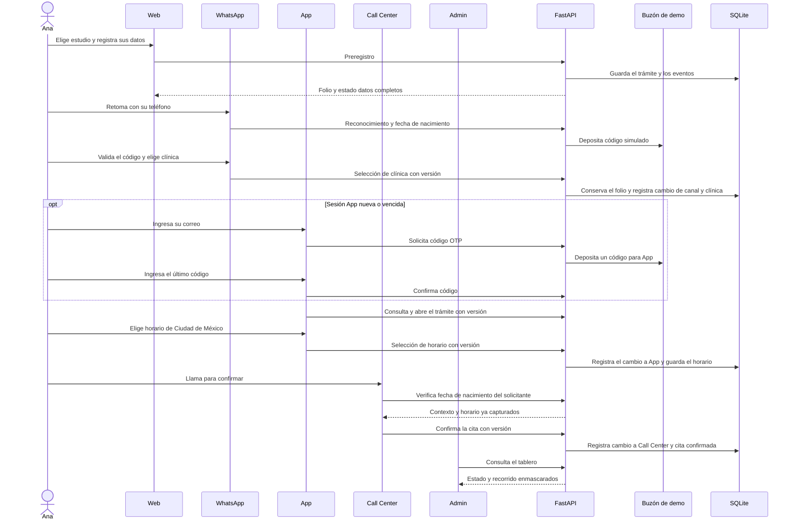
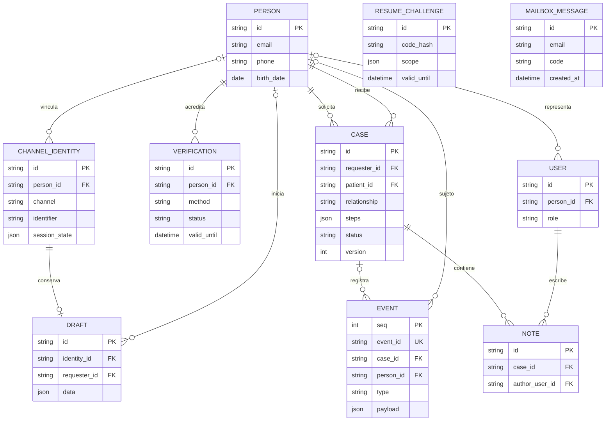

# Arquitectura

## Componentes

## Recorrido de Ana

## Modelo de datos

`RESUME_CHALLENGE.scope` representa el alcance temporal de la retoma. El buzón es una simulación de entrega por correo y carece de una relación por clave externa.

## Diferencias conocidas con SPEC.md

| Tema | Implementación |
|---|---|
| Reagendar desde App | Función opcional pendiente. La App inicia, retoma y confirma trámites. |
| Folio corto de retoma y búsqueda por teléfono con fecha | La retoma usa correo con OTP. App muestra el identificador de trámite existente como folio. |
| Abandono | Hay ejemplos en el seed y recuperación al retomar. La tarea periódica y `POST /demo/cases/{id}/abandon` siguen pendientes. |
| Verificación asistida | El asesor valida la fecha de nacimiento. El dictado de OTP al asesor sigue pendiente. |
| Borradores | La persistencia indexada usa `drafts` y los adaptadores conservan el estado de canal en `channel_identities.session_state`. |
| Reset HTTP | Conserva el modo demo y el comando existente. El seed complementario exige admin y modo demo. |
| Canales reales | Correo, WhatsApp y llamadas se simulan. El buzón demo público muestra los códigos por correo. |
| Un solo origen | La configuración local usa proxy de Vite. El empaquetado en FastAPI está en [propuesta](DEPLOYMENT.md). |
