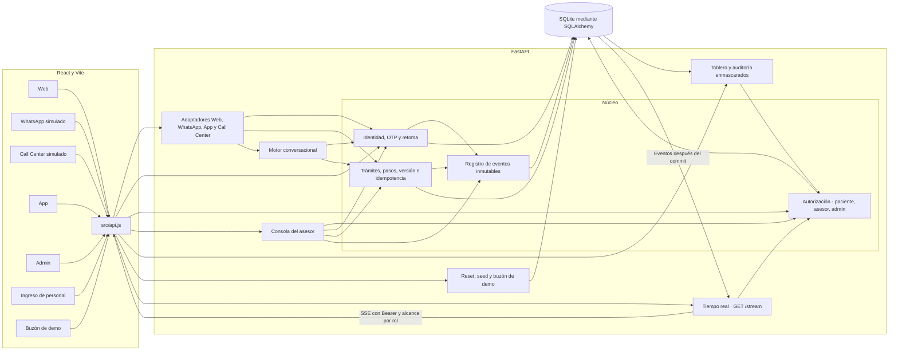
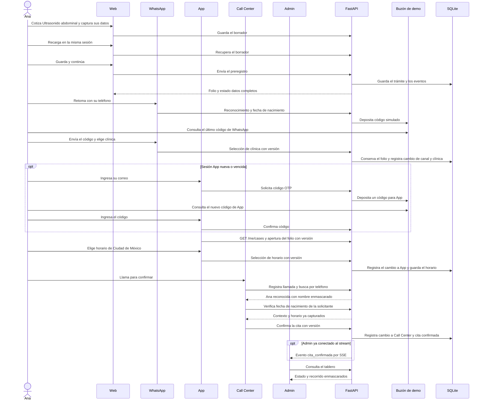
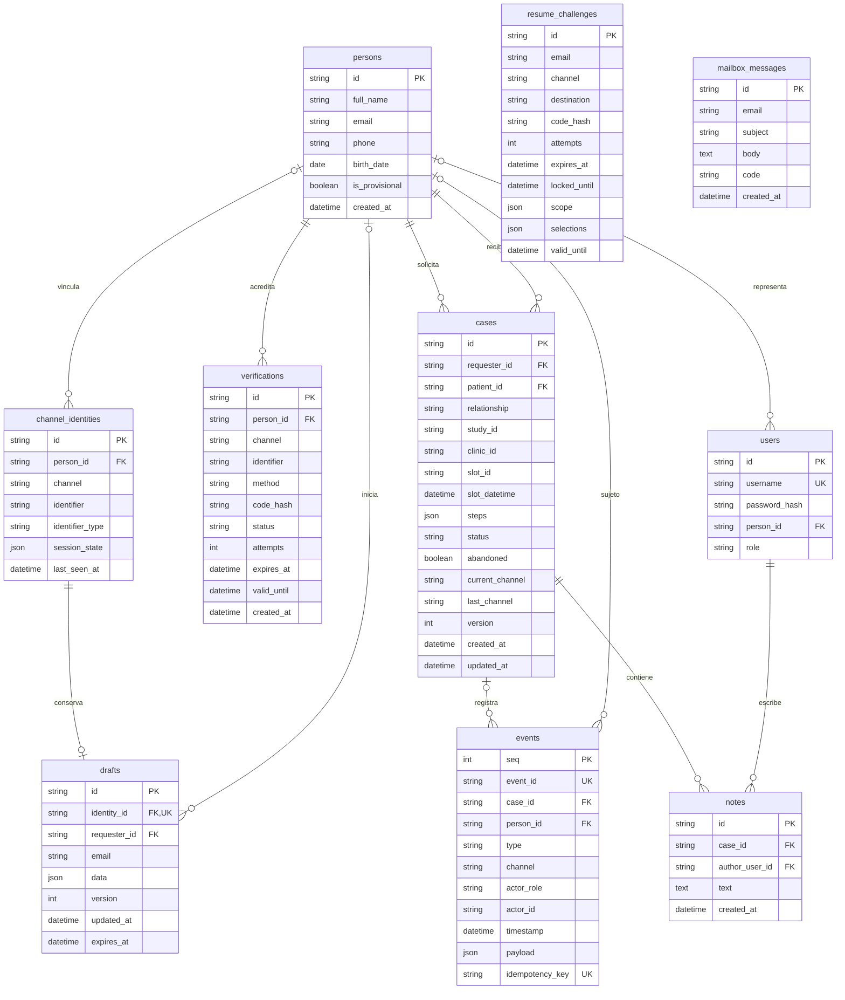

# Arquitectura de Digna Journey

## Arquitectura de la solución

React usa `frontend/src/api.js` como único cliente HTTP. Con la configuración local por defecto, Vite reenvía las solicitudes de API a FastAPI. Los adaptadores reciben interacciones con la clave del canal y las convierten en operaciones del dominio. El motor conversacional determina el siguiente paso en el chat simulado.

Los cambios del trámite y sus eventos se guardan en la misma transacción. SSE lee eventos ya confirmados, enmascara la salida y permite reanudar con `Last-Event-ID`. El administrador ve el feed enmascarado. El asesor recibe actualizaciones correspondientes a su alcance verificado. Los pacientes usan su sesión de canal y los endpoints de trámites.

## Recorrido de Ana entre canales

## Modelo de datos

Los nombres de entidades corresponden a las diez tablas de `backend/app/models.py`. Las relaciones indican las claves externas del ORM.

`channel_identities` tiene una restricción única sobre `(channel, identifier)`. `resume_challenges.scope` y `selections` guardan el alcance y las selecciones de retoma en JSON. El buzón y los desafíos de retoma se buscan por correo. Los identificadores de estudio, clínica y horario se refieren al catálogo definido en código. El identificador de llamada se conserva en los eventos correspondientes.

## Diferencias conocidas con SPEC.md

| Tema | Implementación |
|---|---|
| Reagendar desde App | Función opcional pendiente. La App inicia, retoma y confirma trámites. |
| Folio corto de retoma y búsqueda por teléfono con fecha | La retoma usa correo con OTP. App muestra el identificador de trámite existente como folio. |
| Abandono | Hay ejemplos en el seed y recuperación al retomar. La tarea periódica y `POST /demo/cases/{id}/abandon` siguen pendientes. |
| Verificación asistida | El asesor valida la fecha de nacimiento. El dictado de OTP al asesor sigue pendiente. |
| Borradores | La persistencia indexada usa `drafts` y los adaptadores conservan el estado de canal en `channel_identities.session_state`. |
| Reset HTTP y seed | `POST /demo/reset` comprueba `DEMO_MODE` y está disponible sin token en modo demo. `POST /demo/seed` exige también rol de administrador. |
| Canales reales | Correo, WhatsApp y llamadas se simulan. El buzón demo público muestra los códigos por correo. |
| Un solo origen | La configuración local usa proxy de Vite. El empaquetado en FastAPI está en [propuesta](DEPLOYMENT.md). |
